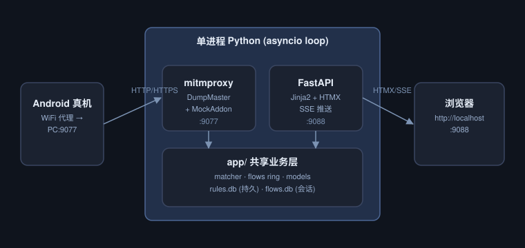
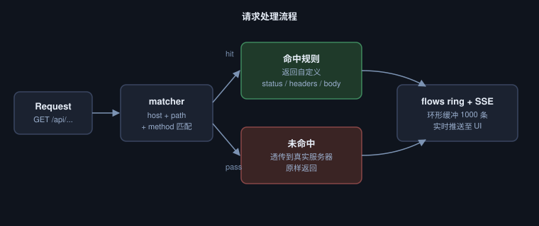

# mock-server

本地 HTTP/HTTPS 代理 + Web UI，按规则改返回值，支持 Android 和 iOS 真机调试。

- 抓所有经过代理的流量，实时显示
- 按 host / path / method 配置 mock 规则，命中则替换 status / headers / body
- 未命中的请求透传到真实服务器

## 架构



单进程 Python：一个 asyncio loop 里同时跑 mitmproxy（DumpMaster）和 FastAPI（uvicorn）。两边共用 `app/` 下的业务层（规则匹配、流量缓冲、SQLite）。

## 请求流程



## 技术栈

- Python 3.14
- [mitmproxy](https://mitmproxy.org/) 11+ — 代理内核
- FastAPI + Jinja2 + HTMX — Web UI（SSE 推送流量）
- SQLite — `rules.db` 持久化规则与设置，`flows.db` 会话级保存请求/响应体

## 端口

| 端口 | 用途 |
| ---- | ---- |
| 9077 | 代理端口（手机 WiFi 代理填这个） |
| 9088 | Web UI（浏览器打开 `http://localhost:9088`） |

## 启动

```bash
uv sync --locked
# 首次配置：复制 .env.example 为 .env，填写凭据文件路径
uv run main.py
```

打开浏览器访问 <http://localhost:9088>。

页面采用统一的浅色调试工作台：顶部为主导航，下方工具栏集中显示页面说明、统计与操作。规则页以紧凑接口行展示名称、路径和响应状态切换，宽屏时操作位于右侧，窄屏自动移到下方；流量页采用网络请求列表，帮助页按通用准备、平台接入和常见问题组织阅读区域。

顶部切换规则、流量和帮助时，各页面在当前浏览器会话中分别保留内容区的滚动位置；带分类或帮助锚点的跳转优先定位到指定内容。

规则页按业务域和页面展示全部接口，支持折叠业务域；左侧固定分类导航，点击业务域或页面分类会自动展开并跳转到对应位置，滚动内容时同步高亮当前分类。不提供搜索或筛选。切换接口状态时只刷新当前接口行、共享副本及启用数量，不重绘整个列表，保留滚动位置、键盘焦点和分类展开状态；整体 Mock 开关沿用局部更新，并直接显示开启 / 关闭状态。

每个域下按页面分组，未确认归属的接口保留在“未分类”。Case 的页面归属：

| 页面 | 接口 |
| ---- | ---- |
| Overview | CaseListItem-My、CaseListItem-All |
| List | 与 Overview 共用的 My / All、CaseSystem |
| Detail | CaseListItem-Detail、CaseCloseButtonStatus、IncidentHeader、IncidentMessageAuth |

System 域“system list”包含 `CACCloudAvaStatus` 的集合请求；“system detail”包含 `CACCloudAvaStatus('…')` 的带键请求、`CACSystemDetailHeader` 和 `SystemBundle`。集合与带键请求解析 URL path 后互斥匹配，开关独立，不依赖具体系统键值、host、`/backend` 前缀或 query 顺序。其他 System 接口保留在“未分类”。

System 下还按已确认页面归类：“bundle list”包含 `BundleStatuses`；“bundle detail”包含 `BundleSubscriptions`、`BundleDetailHeader` 和 `BundleSystem`。`BundleSystem` 与 `system detail` 中的 `SystemBundle` 是不同端点，不合并；这些 Bundle 分类只调整展示归属，不修改规则配置、默认快照或启用状态。

Calendar 下“calendar list”归入 `/odata/calendar/TimelineEvents`、`/odata/mobile/EventType`（单数）和 `/odata/mobile/CalendarSettings`。不把错误服务路径或相近名称当作对应接口，其他 Calendar 接口保留在“未分类”。

基于真实抓包确认，EventType 和 CalendarSettings 的响应均为 OData `value` 集合。首次新版启动会先备份 `data/rules.db.bak-calendar-list-v1`，再事务新增两个缺失接口的三态，全部默认关闭并同时保存初始默认快照。无数据响应保留 `@odata.context` 的协议片段和空 `value: []`，不保存真实 host、业务条目或动态 ETag；403 / 500 沿用预设的空响应体。新规则通过 `calendar-list` 分类限制精确集合路径，避免误匹配 EventTypes、相近名称或带键详情；已有 TimelineEvents 等规则和运行状态不变。迁移幂等，遇到已有相关自定义规则会明确报错，不静默覆盖。此迁移同样只在手动重启新版时执行。

首次新版启动会备份 `data/rules.db.bak-system-paths-v1`，再事务拆分原 `CACCloudAvaStatus` 三态：原 ID 保留为集合，详情复制相同配置、启用状态和预设状态身份。原命中次数不变，新增详情规则计数从零开始；域总计按独立匹配身份去重。已有默认快照原文不被覆盖，迁移映射保证恢复旧默认时仍限定对应集合 / 详情路径，不恢复成覆盖两页的宽泛匹配。重复启动不重复拆分；自定义匹配或启用状态冲突明确报错，不覆盖。真实运行库只在手动重启新版时迁移。

每条接口规则支持“透传 / 无数据 / 无权限 / 服务错误 / 自定义”五种选项，并保留铅笔编辑图标，未启用时也可编辑；点击接口行的空白、名称或 URL 区域同样打开编辑抽屉，状态切换和说明按钮仍独立执行各自功能。铅笔支持键盘操作，底部不增加操作区。

接口名称旁的复制图标可复制当前显示的接口名称，不包含请求方法、路径或状态；复制成功或失败会明确提示，不打开编辑抽屉。

长接口标题单行显示，超出宽度时以省略号结尾；悬停或键盘聚焦时滚动显示完整标题，移开后复原。点击接口标题或行内空白打开当前状态的详情；点击铅笔图标或详情中的「编辑」进入编辑。复制、说明和响应状态按钮各自独立操作。

首次点击“自定义”打开独立响应配置，以该接口现有的无数据响应为起点（没有则使用已有响应），可编辑状态码、Response Headers 和 Body；取消不创建规则。保存时新建同一匹配条件下的独立自定义状态，默认关闭，不覆盖预设或改变当前启用状态。保存后点击“自定义”才启用并直接返回保存的响应，不访问真实服务器；“透传”仍返回真实响应。每个接口只保存一份自定义响应，重复提交明确提示冲突。自定义身份不随状态码改变，编辑和恢复默认保留启用状态；跨页面的共享接口同步内容与开关，接口总计不增加。此功能复用现有数据库字段，无需批量迁移；已运行服务需手动重启以加载新增路由，重启前请保存需要的抓包。

自定义编辑中可选择“抓取真实响应”：确认离开当前未保存表单后，在 App 中触发一次接口。仅下一次符合原 URL、方法及请求分类的请求绕过 Mock，真实响应的状态码、Headers 和完整文本 Body 会填入编辑表单，再由用户修改并保存；服务器不会主动重放请求或读取设备认证信息。已保存自定义内容不自动覆盖，预设与整体开关不变。再次抓取可从自定义规则的铅笔编辑进入。

等待请求和响应共计最多 60 秒；取消、关闭抽屉或离开页面会结束任务，网络失败和超时明确提示。成功抓取的数据只作为未保存表单内容，普通流量记录仍沿用已有记录方式；抓取不依赖流量列表是否被过滤、清空或截断。最多并行保留 8 个任务，完成结果最多暂存 5 分钟，读取后释放；相同接口不允许重复等待。支持完整文本响应最多 2 MiB（解压后及转为 UTF-8 后均受限），超过限制或二进制响应明确报错，不能将截断数据保存成自定义响应。压缩与字符编码会解码，并移除原 Content-Encoding、Content-Length 及逐跳 Headers，文本 Content-Type 统一为 UTF-8，避免编辑后的 Mock 响应出现长度或编码不一致。

有匹配或共享状态说明时，在铅笔左侧显示信息 SVG 图标，悬停、聚焦或点击可查看提示，Escape 或点外部关闭；正文不再重复展示说明，没有说明则不显示空图标。打开后在编辑抽屉中明确选择无数据、无权限或服务错误规则，并可进入详情或恢复默认；默认编辑当前启用态，透传时先显示无数据（没有则显示已有态），选择查看或编辑不会启用规则。详情沿用流量详情抽屉布局，展示保存的匹配条件、分类、返回码、Response Headers 和 Response Body，并可确认后“恢复默认”；不关联真实抓包，也不编造请求头、请求体或耗时。默认是当前已保存配置的持久快照，而非统一系统模板；首次启动新版会先备份 `data/rules.db.bak-rule-defaults-v1` 再捕获现有配置，新建规则也保存自己的初始快照，后续编辑不会覆盖它。默认不包含启用状态、命中次数或时间等运行信息。

编辑和恢复仅修改选定规则的配置，保留启用状态和命中次数；有冲突时提示错误，不覆盖其他规则。原有状态身份单独保存，修改返回码后仍可从原“无数据 / 无权限 / 服务错误”入口访问。保存与恢复以局部更新同步共享卡片、启用统计和详情，不整页跳转。数据库升级在手动重启新版时执行，不在旧进程上直接改库；重启前请保存需要的抓包。

跨页面的 My / All 使用同一组规则和状态，域计数与总计去重。CaseListItem 的“请求分类”解析 URL 解码后的 `$filter`：My 为 `auth eq 'ME'`，All 为 `auth eq 'ALL'`（两者都不含 pointer）；Detail 为非空的 `pointer eq '…'`。匹配不依赖 query 参数顺序、空格编码、具体案件 ID 或 `OPEN` 状态。仅接受由 `and` 连接的字符串等值条件；歧义表达式（如 `or`、重复字段或重复 `$filter`）不命中分类规则。普通规则仍按完整 URL 通配匹配，编辑时可选择请求分类。

首次启动新版会先备份 `data/rules.db.bak-case-pages-v1`，再事务迁移旧版 CaseListItem 三态：原 ID 保留为 My，复制为 All 和 Detail，各自保留原响应与启用状态；新增三个缺失接口默认关闭，不修改其他规则。遇到自定义规则或多态同时启用等冲突会明确报错，不批量覆盖。IncidentMessageAuth 返回对象，其“无数据”为 `{}`，其他新增接口为空 `value` 集合。迁移只执行一次；备份保留原规则和计数。**已运行的进程需要手动重启**以加载新路由、匹配逻辑与迁移；重启会按既有行为清空会话抓包，需先保存需要的流量。

流量详情和规则详情的 Response Body 支持「阅读 / JSON」切换，完整 JSON 默认进入阅读模式。对象、数组及长字符串可折叠；字符串解开外层 JSON 转义，保留代码围栏和语言标记，围栏内的合法 JSON 另做缩进。长字段的「复制内容」复制解码后的字段原文；流量的「复制 / 下载」仍获取完整原始 body。非 JSON、截断内容或嵌套过深时回退到原有展示，阅读模式不修改保存的规则或响应。

## 目录结构

```
mock-server/
├── main.py             # 单进程入口，FastAPI app + mitmproxy lifespan
├── pyproject.toml      # uv 依赖声明
├── uv.lock             # 锁定依赖
├── .env.example        # 本地配置示例
├── app/                # 业务层（UI 无关）
│   ├── db.py           # rules.db / flows.db
│   ├── models.py       # rules / flow_bodies / settings CRUD
│   ├── matcher.py      # 规则匹配 + 冲突检测
│   ├── flows.py        # 流量环形缓冲 + asyncio Queue 订阅
│   ├── addon.py        # MockAddon（应用规则）
│   └── proxy_addon.py  # 原始 req/resp 入库
├── web/
│   ├── routes.py       # 所有 UI 路由
│   ├── templates/      # Jinja2 模板
│   └── static/app.css
├── docs/               # 架构图
└── data/               # 运行时 SQLite
```

## 手机配代理（HTTPS 抓包）

完整步骤见 Web UI 的「帮助」页：通用准备集中展示，Android 指南在左，iOS 指南在右，窄屏自动上下排列。

### 通用准备

1. 手机和电脑连接同一个 Wi-Fi，先用手机浏览器访问 `http://<电脑 IP>:9088` 验证连通。
2. 在当前 Wi-Fi 中设置手动代理，服务器填电脑局域网 IP，端口填 `9077`。
3. 设置代理后访问 `http://mitm.it`（iOS 使用 Safari），选择对应平台下载证书。

### Android

1. Wi-Fi → 当前网络 → 高级选项 → 代理 → 手动。
2. 将下载的 `mitmproxy-ca-cert.cer` 安装到「CA 证书」。
3. 面向 Android 7+ 的 App 默认不信任用户 CA。自己的测试 App 在 `network_security_config.xml` 的信任配置中加入 `<certificates src="user"/>`，确保 Manifest 引用该配置，建议仅用于 debug 构建。其他测试方案需在具备 root 权限的设备或模拟器上安装为系统 CA，具体方式随 Android 版本不同。

### iOS

1. 设置 → Wi-Fi → 当前网络右侧 ⓘ → 配置代理 → 手动。
2. 下载证书后，在「设置 → 通用 → VPN 与设备管理」中安装 mitmproxy 描述文件。
3. 在「设置 → 通用 → 关于本机 → 证书信任设置」中开启 mitmproxy 根证书的完全信任。只安装描述文件还不够。
4. 使用系统默认 HTTPS 校验的 App（如普通 URLSession 请求）通常无需修改代码，也不需要为了 HTTPS 代理抓包关闭 ATS。

两端若启用 SSL Pinning（证书绑定）或自定义证书校验，还需要调整测试版本中的校验。请求接口、方法和匹配条件相同时，可共用现有 Mock 规则。接入后到「流量」页验证 HTTP / HTTPS 请求，再启用规则验证 Mock；测试结束后关闭手机 Wi-Fi 代理。

## 测试通知（指定设备 / 全局发送）

顶部“发通知”页（http://localhost:9088/push）分为发送通知、发送历史和使用帮助。默认用表单选择 Incident / CAC Event / CAC / Community 或自定义 source，选择指定设备并填写 Token，或选择全局发送并填写 Topic，再填写标题、正文、目标 ID 和附加 data；也可切换完整 JSON 编辑，保留 android / apns 等消息选项。通知预览随编辑同步。类型切换只替换仍使用默认值的标题和正文，并清空旧目标 ID，避免把案例 ID 发成事件 ID。支持 token 单设备和 topic 群发，二者必须且只能选择一个；不支持 condition，不自动重试。全局发送默认 Topic 为 all_users，仅覆盖成功订阅该 Topic 的设备。客户端需先调用 FirebaseMessaging.getInstance().subscribeToTopic("all_users") 并确认成功，或由受信任服务端通过 Firebase Admin SDK 订阅已有 Token；未订阅的设备不会收到，mock-server 不会自动订阅或修改 Android App。

在项目根目录 .env 中配置具有发送权限的 Google 身份（首次可复制 .env.example）：

    FCM_PROJECT_ID=sap-for-me-android-internal
    GOOGLE_APPLICATION_CREDENTIALS=./credentials/fcm-service-account.json

后续直接执行 uv run main.py，或在 IDE 中运行 main.py，不需要手动 export。相对凭据路径从项目根目录解析，IDE 工作目录不同也适用。首次执行 uv sync --locked，IDE 解释器选择项目 .venv/bin/python。显式进程环境变量优先于 .env，临时覆盖后要恢复常规配置可移除对应环境变量。

也可使用 Google Application Default Credentials，或通过 FCM_ACCESS_TOKEN 环境变量提供短期 OAuth 访问令牌（优先使用；过期后需要更新）。发送身份需要 cloudmessaging.messages.create 权限，例如 Firebase Cloud Messaging API Admin（roles/firebasecloudmessaging.admin）。Firebase 控制台的查看权限不能替代 API 发送权限；服务账号文件不能提交到仓库。发送请求仅允许从服务器本机、同源 localhost / 127.0.0.1 / IPv6 loopback 页面发起。FCM 请求直接连接 Google，不经过环境 HTTP 代理。

测试案例 noauth：data.source 填 Incident，sourceId 填案例 pointer；启用整体 Mock，并把 Case Detail 的 CaseListItem-Detail 切换到“无权限”。手机连接本代理后点击收到的通知，详情接口返回 403。云事件使用 CAC Event 和事件 ID，需要对应事件详情头部接口返回 403。直接发通知不会写入后端通知列表；FCM 接受消息也不保证手机一定展示。

已有进程需手动重启才能加载本功能；重启会按原有行为清空会话抓包，先保存需要的数据。本功能不迁移规则数据库。

发送历史保存到独立的 data/push.db，保留最近 100 次通过 JSON 校验的发送尝试，按新到旧排序，服务重启后保留。历史包含完整消息和设备 Token 或 Topic，列表显示设备指纹或 Topic，详情默认遮盖 Token；“载入编辑”恢复原消息供修改，不自动重发；“重新发送”立即向原设备或原 Topic 当前订阅设备发送完整原消息，保留附加 data、android / apns 等选项，并新增一条结果记录，不覆盖原记录。发送期间按钮禁用以避免连续点击。历史项目与当前项目不一致时提示先载入编辑确认，不直接重发。可按类型、结果及标题 / 正文 / 目标 ID / 设备编号 / Topic 搜索。历史接口只允许服务器本机读取，不写入代理流量库，也不存储服务账号或 OAuth 凭据。

状态区分 FCM 已接受、发送失败和结果未知。FCM 已接受只表示服务端接受消息，不代表设备送达。网络超时、无法识别的成功响应或进程中断保留未知结果，不能盲目重发。开始保存历史失败时不发送；FCM 已接受但历史更新失败时仍显示接受成功，同时提示历史未更新。

内置帮助覆盖获取 Token、类型与点击行为、403 noauth 测试、Google Play 服务推送连接和凭据配置。启用本版本前的发送记录未持久化，无法补入新历史；新版从首次发送开始记录。历史使用新库，不修改已有规则或抓包数据库。加载新版路由仍需手动重启，先保存需要的会话抓包。


## uv 与 IDE 启动

依赖仅在 pyproject.toml 中维护，uv.lock 提交到版本库。uv sync --locked 创建或同步 .venv；新增依赖使用 uv add 包名。测试执行 uv run python -m unittest discover -s tests。项目默认 Python 3.14，由 .python-version 指定。

IDE 选择 .venv/bin/python 为解释器，运行配置指向 main.py 后直接点击 Run。不要再使用旧的 venv 解释器。main.py 在加载 Web 路由前自动读取项目 .env；静态资源与凭据路径均从项目目录解析。项目已忽略 .env、credentials/ 和 Firebase Admin SDK 私钥文件；只提交 .env.example。实际服务账号文件继续保留在原位置，不复制到配置或文档中。
